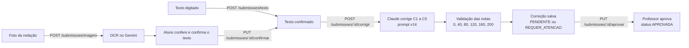

# Domina

Plataforma que corrige redações do ENEM com IA e deixa o professor revisar e aprovar a nota.
Este README explica o **fluxo do agente de correção da redação**: o que entra, o que ele faz e o
que sai. Para o frontend, veja [`frontend/README.md`](frontend/README.md).

## Visão geral



A IA nunca dá a nota final sozinha. Ela gera uma nota **provisória**; o professor da turma confirma
ou muda cada competência antes de a correção virar **APROVADA**.

| Etapa | Onde está no código | Modelo |
|---|---|---|
| Ler a foto (OCR) | `backend/app/ocr/gemini.py`, `backend/app/routers/ocr.py` | Gemini (`gemini-3.5-flash`, reserva `gemini-3.5-flash-lite`) |
| Corrigir a redação | `backend/app/correcao.py`, `backend/app/llm/claude.py` | Claude (`claude-sonnet-5-5`) |
| Rotas do fluxo | `backend/app/routers/submissoes.py` | |
| Formato de entrada e saída | `backend/app/schemas/submissao.py` | |

## 1. Entrada (inputs)

O agente corrige um **texto confirmado** e um **tema**. O texto chega de dois jeitos:

**a) Foto da redação** (`POST /submissoes/imagem`, multipart com `file`, `atividade_id` e,
se quem envia é o professor, `aluno_id`)
1. A imagem precisa ser `image/*` e ter até 10 MB.
2. Uma cópia reduzida (lado maior de 1600 px, já desvirada pelo EXIF) vai ao Gemini. A foto
   original fica salva em `UPLOAD_DIR` para o professor ver depois.
3. O prompt de OCR pede para transcrever **palavra por palavra, sem corrigir nada** (os erros do
   aluno contam na C1), escrever `[ilegível]` no que não der para ler, pular trechos riscados e
   ignorar o cabeçalho (nome, CPF, inscrição) e a numeração das linhas.
4. Se o Gemini principal estiver sem cota ou sobrecarregado (erro 429, 503, 504 ou tempo
   esgotado), tenta o modelo reserva.
5. O texto lido fica em `texto_ocr`. O aluno (ou professor) confere, corrige o que o OCR leu
   errado e confirma com `PUT /submissoes/{id}/confirmar` (`{"texto": "..."}`). Depois de
   confirmado, o texto não muda mais.

Erros do OCR: sem chave do Gemini = 503; nenhum texto na foto = 422; redação já publicada na
internet (o Google bloqueia por "recitation") = 422; outra falha = 502, sem vazar detalhe interno.

**b) Texto digitado** (`POST /submissoes/texto`, `{"atividade_id", "aluno_id"?, "texto"}`): já
nasce confirmado, sem etapa de OCR.

**Tema:** vem no corpo de `POST /submissoes/{id}/corrigir` (`{"tema": "..."}`, até 500
caracteres). Se não vier, usa o título da atividade. O tema importa para a C2 (fuga ou tangência).

**Quem dispara a correção da IA:** o aluno dono da redação ou o professor da turma. O aluno só
**pede** a correção automática e vê a nota da IA como provisória; ele não dá nem muda nota. A
nota final é sempre do professor (ver 2.5). A matéria precisa ter as 5 competências (C1 a C5)
cadastradas, e cada redação passa pela IA uma vez só (a segunda tentativa dá 409).

## 2. Lógica (o que o agente faz)

A função `corrigir(texto, tema)` em `backend/app/correcao.py` monta o prompt e faz **uma única
chamada** ao Claude. A IA age como **um corretor** do ENEM. (A correção dupla, com média de dois
corretores, foi testada e não melhorou o erro.)

### 2.1 O prompt (versão v14)

O prompt fica na constante `PROMPT`, e a versão em `VERSAO_PROMPT = "v14"`. Ele obriga a IA a
corrigir em **duas etapas**:

**Etapa 1: levantar evidências, sem dar nota.** Para cada competência, a IA lista o que vê no texto,
citando trechos:
- **C1:** cada desvio gramatical e cada falha de estrutura sintática, com o tipo. Palavras riscadas
  pelo próprio aluno não contam (é autocorreção permitida pelo ENEM), nem caracteres estranhos de
  digitalização, nem `[ilegível]`.
- **C2:** cada repertório externo (livro, filme, lei, dado histórico...) e se ele é
  **legitimado**, **pertinente** ao tema e **produtivo** (ligado ao argumento). Informação tirada
  só dos textos motivadores não conta.
- **C3:** a tese, o argumento de cada parágrafo e se a progressão é lógica.
- **C4:** os conectivos, o sentido de cada um, os repetidos e como começa cada parágrafo.
- **C5:** agente, ação, meio/modo, finalidade e detalhamento, cada um PRESENTE ou AUSENTE, e se
  respeita os direitos humanos.

**Etapa 2: escolher o nível de cada competência**, com as regras abaixo.

| Competência | Regra principal do v14 |
|---|---|
| C1 (norma culta) | Nota pela **contagem** de desvios: 200 = até 2 desvios de tipos diferentes e até 1 falha de estrutura (o mesmo erro repetido tira o 200); 160 = até 5 desvios e até 3 falhas (nível mais comum); 120 = 6 a 9 desvios; 80 = 10 ou mais. Na dúvida entre 120 e 160 com 5 desvios ou menos, dá 160. |
| C2 (tema e repertório) | Sem repertório externo legítimo e pertinente, no máximo 120. **Piso do v14:** com pelo menos um repertório externo legítimo e pertinente, no mínimo 160. Repertório ligado ao argumento = 200; só citado = 160. |
| C3 (argumentação) | 160 é o nível mais comum. 200 só quando todos os parágrafos de desenvolvimento mostram autoria além do previsível. Na dúvida entre 160 e 200, dá 160. |
| C4 (coesão) | 200 = pelo menos 2 conectivos diferentes, todos com o sentido certo, e um conectivo no início de cada parágrafo do 2º ao último. Caligrafia e rasura não contam. |
| C5 (proposta) | Conta os 5 elementos: 5 = 200, 4 = 160, 3 = 120, 2 = 80, 1 = 40. Zero só sem proposta ou com desrespeito aos direitos humanos. |

Regras gerais: cada competência é avaliada de forma independente; só desce de nível com evidência
citada; justificativa sempre com trecho; no 200 não se sugere melhoria.

A evolução do prompt (v1 a v21), com os resultados de cada teste, está em
[`docs/calibracao/historico_versoes_prompt.md`](docs/calibracao/historico_versoes_prompt.md).
O texto completo do v14 também está em `docs/calibracao/2026-10-20/prompt_v14.txt`.

### 2.2 Chamada ao modelo

`backend/app/llm/claude.py` chama o Claude (`ANTHROPIC_MODEL`, padrão `claude-sonnet-5-5`) e força
a resposta no formato do schema `ResultadoIA` por meio de uma *tool* (`responder_correcao`). Usa até
16.000 tokens de saída, porque a Etapa 1 gera bastante texto.

> Os números de calibração do v14 (erro médio de 48 pontos nas 53 redações com nota oficial do
> INEP) foram medidos com o Gemini flash-lite, antes da troca do provedor da nota para o Claude.

### 2.3 Validação

O schema Pydantic em `correcao.py` confere a resposta da IA:
- **`NOTAS_VALIDAS = {0, 40, 80, 120, 160, 200}`**: cada corretor do ENEM só usa esses níveis.
  Nota fora disso é arredondada para o nível mais próximo; no empate (ex.: 60) fica com o menor,
  para não inflar a nota.
- Precisa vir **C1 a C5, uma vez cada** (a lista é ordenada por código).
- Cada competência tem de 1 a 6 `pontos`; `confianca` entre 0 e 1.
- Se o modelo não devolver um JSON válido, a rota responde 502 e nada é salvo.

### 2.4 Nota total e status

Em `corrigir_submissao` (`backend/app/routers/submissoes.py`):
- **`nota_ia` = soma das 5 competências** (0 a 1000).
- O status nasce **PENDENTE**, ou **REQUER_ATENCAO** (vai para o topo da fila do professor) quando
  a `confianca` é menor que **0,6** ou quando o modelo usado não foi o principal.
- Fica gravado o `modelo_usado` e a `versao_prompt`, para saber depois qual prompt gerou cada nota.

### 2.5 Aprovação do professor

`PUT /submissoes/{id}/aprovar` com `{"notas": [{"codigo": "C1", "nota": 160}, ...], "feedback"?}`:
o professor manda a nota final de cada competência (também só valores de `NOTAS_VALIDAS`).
`nota_professor` = soma delas, o status vira **APROVADA** e as notas atualizam o domínio do aluno
em cada competência (média móvel). O aluno vê a nota da IA antes disso, mas como provisória.

## 3. Saída (outputs)

**O que a IA devolve** (`ResultadoIA`):

```json
{
  "competencias": [
    {
      "codigo": "C1",
      "analise": "evidências da Etapa 1...",
      "nota": 160,
      "justificativa": "por que ficou nesse nível, com trecho citado",
      "pontos": [
        {"trecho": "trecho copiado da redação", "tipo": "erro", "comentario": "1 frase curta"},
        {"trecho": "outro trecho", "tipo": "acerto", "comentario": "1 frase curta"}
      ]
    }
  ],
  "confianca": 0.8,
  "feedback_geral": "2 a 4 frases para o aluno sobre o que mais vale melhorar"
}
```

A `analise` fica antes da `nota` de propósito: força a IA a pensar antes de decidir. Ela não é
salva nem mostrada; serve só para a IA chegar na nota.

**O que a API devolve** (`CorrecaoResponse`, em `POST /submissoes/{id}/corrigir` e
`GET /submissoes/{id}/correcao`):

| Campo | O que é |
|---|---|
| `nota_ia` | Soma das 5 competências dada pela IA (0 a 1000) |
| `nota_professor` | Soma das notas do professor; `null` até aprovar |
| `confianca` | De 0 a 1, o quanto a IA está segura |
| `status` | `PENDENTE`, `REQUER_ATENCAO` ou `APROVADA` |
| `modelo_usado` | Modelo que fez a correção |
| `feedback` | `feedback_geral` da IA (o professor pode trocar ao aprovar) |
| `criterios[]` | Uma linha por competência: `codigo`, `nome`, `nota`, `nota_professor`, `justificativa` e `pontos` (trecho, tipo acerto/erro, comentário) |

Os `pontos` servem para o frontend destacar na redação cada trecho com acerto ou erro.

## 4. Como rodar

```sh
# 1. configurar as chaves
cp backend/.env.example backend/.env
# preencher GEMINI_API_KEY (OCR) e ANTHROPIC_API_KEY (nota da redação)

# 2. subir banco + API
docker compose up -d --build
docker compose exec api python seed.py   # dados de exemplo
```

A API fica em `http://localhost:8000` (documentação em `/docs`). Para testar OCR e correção
direto no navegador, abra **`http://localhost:8000/laboratorio/`**.

Sem `GEMINI_API_KEY` a API sobe, mas o OCR responde 503. Sem `ANTHROPIC_API_KEY`, corrigir
redação responde 503.

## 5. Como testar

```sh
cd backend
pip install -r requirements-dev.txt
python -m pytest
```

Os testes usam SQLite temporário e trocam o OCR e a IA por versões falsas, então não gastam cota
nem precisam de chave. Os que cobrem o agente estão em `backend/tests/test_fluxo_envio.py`:
foto → OCR → confirmação → correção → aprovação, arredondamento para níveis válidos do ENEM,
uma correção só por redação e status `REQUER_ATENCAO` com modelo diferente do principal.

Para medir o prompt contra notas reais do INEP, use os scripts de calibração em
`backend/calibracao/` e `docs/calibracao/` (explicados no `CLAUDE.md` e no histórico de versões).
