# Domina

Plataforma de correção com IA para escolas: a IA corrige e o professor revisa e aprova a nota.

## O objetivo: um modelo próprio, treinado por matéria

> **O Domina está desenvolvendo e treinando o seu PRÓPRIO modelo de IA, personalizado por
> matéria.** O produto é o agente somado a esse modelo: o agente orquestra o fluxo de correção e
> o modelo próprio, vai aprender o conteúdo de cada
> matéria e corrigir. O modelo é acessado por uma camada única de inferência
> (`backend/app/llm/`, `backend/app/ocr/`), de modo que cada versão treinada entra no fluxo sem
> mudar o resto do sistema.

O Domina vai cobrir **todas as matérias**, e cada escola vai poder ensinar a IA a corrigir a
matéria dela. Exemplo, numa escola de música:

1. O professor entra no Domina e cria uma **nova matéria** (ex.: Teoria Musical).
2. Abre a aba **"Treinar IA"**.
3. Envia os materiais da matéria (apostilas, rubricas, gabaritos; por exemplo, 5 arquivos).
4. A IA é treinada com esses materiais, aprende o conteúdo e passa a guardar tudo o que precisa para
   corrigir aquela matéria.
5. A partir daí, as atividades dessa matéria são corrigidas com base no que ela aprendeu.

**O que o MVP tem hoje:**
- **Redação no estilo ENEM** (C1 a C5), corrigida por competência.
- **Matemática**, corrigida questão por questão contra o gabarito do professor.
- **Agente de correção**: decide sozinho os passos de cada envio e usa os corretores como
  ferramentas (veja a seção "O agente de correção").
- O envio de materiais de uma matéria já existe (`POST /materias/{id}/documentos`), mas por
  enquanto só guarda os arquivos. O treino do modelo com esses materiais está em desenvolvimento,
  e a ligação do upload ao treino é a etapa que está sendo integrada.

O resto deste README explica o **fluxo do agente de correção** como ele está hoje, para a
redação e para matemática: o que entra, o que ele faz e o que sai. Para o frontend, veja
[`frontend/README.md`](frontend/README.md).

## Visão geral do fluxo

```mermaid
flowchart LR
    P[Professor cria a atividade<br/>redação, ou questões + gabarito + valor] --> A
    A[Foto da resposta] -->|POST /submissoes/imagem| B[OCR]
    B --> C[Aluno confere e confirma o texto]
    T[Texto digitado] -->|POST /submissoes/texto| D
    C -->|PUT /submissoes/:id/confirmar| D[Texto confirmado]
    D -->|POST /submissoes/:id/corrigir| E{Tipo da matéria}
    E -->|Redação| R[Modelo corrige C1 a C5<br/>prompt v14]
    E -->|Matemática| M[Modelo confere cada<br/>questão com o gabarito]
    R --> F[Validação e nota total]
    M --> F
    F --> G[Correção salva<br/>PENDENTE ou REQUER_ATENCAO]
    G -->|PUT /submissoes/:id/aprovar| H[Professor aprova<br/>status APROVADA]
```



O caminho é o mesmo para as duas matérias até a hora de corrigir. Aí a correção se divide pelo
tipo da matéria. A IA nunca dá a nota final sozinha: ela gera uma nota **provisória**, e o
professor da turma confirma ou muda cada critério antes de a correção virar **APROVADA**.

Cada etapa de IA fica atrás de uma única função, para trocar de versão do modelo sem mexer no resto.

| Etapa | Onde está no código |
|---|---|
| Agente (decide os passos) | `backend/app/agente.py`, `backend/app/routers/agente.py` |
| Ler a foto (OCR) | `backend/app/ocr/gemini.py`, `backend/app/routers/ocr.py` |
| Corrigir a redação | `backend/app/correcao.py`, `backend/app/llm/claude.py` |
| Corrigir matemática | `backend/app/correcao_exatas.py` |
| Rotas do fluxo | `backend/app/routers/submissoes.py` |
| Formato de entrada e saída | `backend/app/schemas/submissao.py` |

Tipos de matéria (`TipoMateriaEnum`): `REDACAO_ENEM` e `REDACAO_OUTRO_VESTIBULAR` vão para a
correção de redação; `MATERIA_OBJETIVA` e `MATERIA_DISCURSIVA` (matemática, física, química...)
vão para a correção de matemática.

## O agente de correção

Além do fluxo fixo acima (foto → texto → nota), existe o **agente**: em vez de o código seguir uma
ordem fixa, a IA **recebe um objetivo e decide sozinha quais ferramentas usar**. Os corretores
que já existiam (redação, matemática, gerador de exercícios) viram *ferramentas* dela. O agente
**não corrige de um jeito novo**: ele decide **quando** e **qual** peça usar.

O que compõe o agente: o objetivo, as ferramentas, as regras, o passo a passo gravado e a
revisão do professor. O modelo que faz o papel de cérebro é plugável (`ANTHROPIC_MODEL` na
configuração), e é por aí que o modelo próprio assumirá a função quando estiver pronto.

**Rotas:** `POST /submissoes/{id}/agente` (roda o agente; aceita `{"tema"?}`) e
`GET /submissoes/{id}/agente` (devolve o último passo a passo gravado). Quem pode rodar é o
mesmo de `/corrigir`: o aluno dono da resposta ou o professor da turma, e o texto precisa estar
confirmado. Sem a chave do serviço de modelo configurada, responde 503.

**O objetivo dado ao agente:** deixar tudo pronto para o professor revisar e para o aluno
estudar. Um caminho típico:
1. `ler_envio`: confere se o texto está legível e completo. Se estiver ilegível, vazio ou
   cortado (OCR ruim), usa `pedir_nova_foto` e termina sem corrigir.
2. Escolhe o corretor certo: `corrigir_redacao_enem` ou `corrigir_exatas` (matemática; a ferramenta errada
   para o tipo da matéria devolve erro, e o agente se corrige).
3. `consultar_historico_aluno`: compara a nota de agora com o domínio por competência e as
   últimas notas.
4. Se for redação, `gerar_exercicios_reforco` para as 1 a 3 competências mais fracas.
5. `sinalizar_professor` **só quando há motivo real** (confiança baixa, queda grande, nota
   muito baixa, suspeita de fuga ao tema, texto muito curto). Isso coloca a correção como
   `REQUER_ATENCAO`, no topo da fila.
6. `finalizar`: sempre o último passo, com uma mensagem motivadora para o aluno e um resumo para
   o professor.

**Regras e travas:**
- **A nota final continua sendo do professor.** A do agente é provisória, igual à do fluxo normal.
- O agente **não inventa nota**: usa só o que as ferramentas devolvem, e **não escolhe o tema da
  redação** (o tema vem do professor ou do título da atividade). Antes, quando ele podia
  escolher, um tema inventado mudava a C2 e piorava a nota.
- Máximo de **10 passos** por execução. Cada ferramenta recebe um "motivo" (uma frase), que o
  professor lê na tela.
- Se o agente cair no meio (erro, recusa, tempo), a **correção direta ainda sai**: o sistema
  roda a correção normal e grava um aviso no passo a passo.
- Cada execução grava no **log de auditoria** (`AGENTE_CORRIGIR`) e os **tokens do agente entram
  no custo da escola**.

**O que fica salvo** (tabela `agente_execucao`, uma por envio; rodar de novo sobrescreve): os
`passos` (pensamento, ferramenta com motivo, entrada e resultado, ou aviso), a `mensagem_aluno`,
o `resumo_professor`, os `exercicios` de reforço e o `modelo_usado`. A resposta da API
(`AgenteResponse`) traz isso mais a `correcao` completa (mesmo formato de `CorrecaoResponse`).

**Na tela:** na revisão do professor (`frontend/src/screens/Activities.tsx`) aparece o card
**"Passo a passo do agente"**, com cada decisão e o motivo.

## 1. Entrada (inputs)

### 1.1 A atividade (o professor prepara)

`POST /atividades` com `materia_id`, `turma_id`, `titulo` e `tipo`:
- **Redação:** não precisa de mais nada. A matéria já tem as 5 competências (C1 a C5)
  cadastradas, e a atividade vale sempre 1000.
- **Matemática:** o professor também manda as **questões com o gabarito**
  (`questoes: [{"enunciado", "resposta_correta"}]`, obrigatório) e, se quiser, o **valor total**
  da atividade (`valor_total`; se não mandar, vale 1000). Cada questão vira um critério `Q1`,
  `Q2`, ... O gabarito só o professor vê.

### 1.2 A resposta do aluno

O agente corrige um **texto confirmado**. Ele chega de dois jeitos, iguais para redação e
matemática:

**a) Foto** (`POST /submissoes/imagem`, multipart com `file`, `atividade_id` e, se quem envia é
o professor, `aluno_id`)
1. A imagem precisa ser `image/*` e ter até 10 MB.
2. Uma cópia reduzida (lado maior de 1600 px, já desvirada pelo EXIF) vai ao modelo de leitura. A foto
   original fica salva em `UPLOAD_DIR` para o professor ver depois.
3. O prompt de OCR pede para transcrever **palavra por palavra, sem corrigir nada** (na redação,
   os erros do aluno contam na C1), escrever `[ilegível]` no que não der para ler, pular trechos
   riscados e ignorar o cabeçalho (nome, CPF, inscrição) e a numeração das linhas.
4. Se o modelo principal estiver sem cota ou sobrecarregado (erro 429, 503, 504 ou tempo
   esgotado), tenta o modelo reserva.
5. O texto lido fica em `texto_ocr`. O aluno (ou professor) confere, corrige o que o OCR leu
   errado e confirma com `PUT /submissoes/{id}/confirmar` (`{"texto": "..."}`). Depois de
   confirmado, o texto não muda mais.

Erros do OCR: sem chave configurada = 503; nenhum texto na foto = 422; texto já publicado na
internet (o Google bloqueia por "recitation") = 422; outra falha = 502, sem vazar detalhe interno.

**b) Texto digitado** (`POST /submissoes/texto`, `{"atividade_id", "aluno_id"?, "texto"}`): já
nasce confirmado, sem etapa de OCR.

### 1.3 O que mais vai para a IA

- **Redação:** o **tema**, que vem no corpo de `POST /submissoes/{id}/corrigir`
  (`{"tema": "..."}`, até 500 caracteres). Se não vier, usa o título da atividade. O tema
  importa para a C2 (fuga ou tangência).
- **Matemática:** o nome da matéria e as questões com o gabarito da atividade. Se a
  resposta veio por **foto**, a foto original também vai junto, para a IA apontar **onde** na
  folha está cada resposta.

**Quem dispara a correção da IA:** o aluno dono da resposta ou o professor da turma. O aluno só
**pede** a correção automática e vê a nota da IA como provisória; ele não dá nem muda nota. A
nota final é sempre do professor (ver 2.5). Cada resposta passa pela IA uma vez só (a segunda
tentativa dá 409).

## 2. Lógica (o que o agente faz)

`corrigir_submissao` (`backend/app/routers/submissoes.py`) olha o tipo da matéria e chama um
de dois corretores. Os dois fazem **uma única chamada** à IA por resposta.

### 2.1 Redação: o prompt (versão v14)

A função `corrigir(texto, tema)` em `backend/app/correcao.py` monta o prompt e chama o modelo de correção.
A IA age como **um corretor** do ENEM. (A correção dupla, com média de dois corretores, foi
testada e não melhorou o erro.)

O prompt fica na constante `PROMPT`, e a versão em `VERSAO_PROMPT = "v14"`. Ele obriga a IA a
corrigir em **duas etapas**:

**Etapa 1: levantar evidências, sem dar nota.** Para cada competência, a IA lista o que vê no texto,
citando trechos:
- **C1:** cada desvio gramatical e cada falha de estrutura sintática, com o tipo. Palavras riscadas
  pelo próprio aluno não contam (é autocorreção permitida pelo ENEM), nem caracteres estranhos de
  digitalização, nem `[ilegível]`.
- **C2:** cada repertório externo (livro, filme, lei, dado histórico...) e se ele é
  **legitimado**, **pertinente** ao tema e **produtivo** (ligado ao argumento). Informação tirada
  só dos textos motivadores não conta.
- **C3:** a tese, o argumento de cada parágrafo e se a progressão é lógica.
- **C4:** os conectivos, o sentido de cada um, os repetidos e como começa cada parágrafo.
- **C5:** agente, ação, meio/modo, finalidade e detalhamento, cada um PRESENTE ou AUSENTE, e se
  respeita os direitos humanos.

**Etapa 2: escolher o nível de cada competência**, com as regras abaixo.

| Competência | Regra principal do v14 |
|---|---|
| C1 (norma culta) | Nota pela **contagem** de desvios: 200 = até 2 desvios de tipos diferentes e até 1 falha de estrutura (o mesmo erro repetido tira o 200); 160 = até 5 desvios e até 3 falhas (nível mais comum); 120 = 6 a 9 desvios; 80 = 10 ou mais. Na dúvida entre 120 e 160 com 5 desvios ou menos, dá 160. |
| C2 (tema e repertório) | Sem repertório externo legítimo e pertinente, no máximo 120. **Piso do v14:** com pelo menos um repertório externo legítimo e pertinente, no mínimo 160. Repertório ligado ao argumento = 200; só citado = 160. |
| C3 (argumentação) | 160 é o nível mais comum. 200 só quando todos os parágrafos de desenvolvimento mostram autoria além do previsível. Na dúvida entre 160 e 200, dá 160. |
| C4 (coesão) | 200 = pelo menos 2 conectivos diferentes, todos com o sentido certo, e um conectivo no início de cada parágrafo do 2º ao último. Caligrafia e rasura não contam. |
| C5 (proposta) | Conta os 5 elementos: 5 = 200, 4 = 160, 3 = 120, 2 = 80, 1 = 40. Zero só sem proposta ou com desrespeito aos direitos humanos. |

Regras gerais: cada competência é avaliada de forma independente; só desce de nível com evidência
citada; justificativa sempre com trecho; no 200 não se sugere melhoria.

A evolução do prompt (v1 a v21), com os resultados de cada teste, está em
[`docs/calibracao/historico_versoes_prompt.md`](docs/calibracao/historico_versoes_prompt.md).
O texto completo do v14 também está em `docs/calibracao/2026-10-20/prompt_v14.txt`.

**Chamada ao modelo:** `backend/app/llm/claude.py` é a camada de inferência (`ANTHROPIC_MODEL`)
e força a resposta no formato do schema `ResultadoIA` por meio de uma *tool*
(`responder_correcao`). Usa até 16.000 tokens de saída, porque a Etapa 1 gera bastante texto.

> Os números de calibração do v14 (erro médio de 48 pontos nas 53 redações com nota oficial do
> INEP) são a régua de qualidade: cada versão treinada do modelo próprio é medida na mesma base.

### 2.2 Matemática: conferir com o gabarito

A função `corrigir(respostas, materia, questoes, imagem)` em `backend/app/correcao_exatas.py`
(versão `exatas-v1`) chama o modelo de correção. Aqui **não há rubrica subjetiva** nem avaliação de estilo:
é uma conferência objetiva, questão por questão.

- O prompt manda cada questão com o enunciado e o gabarito, e as respostas do aluno como foram
  transcritas. As respostas podem estar fora de ordem ou sem número; a IA associa cada trecho à
  questão certa pelo conteúdo.
- A resposta conta como **certa mesmo em outro formato**: `1/2` = `0,5`, `x = 3` = `3`, unidades
  equivalentes. Conta como **errada** se o valor final for diferente do gabarito, mesmo que o
  método pareça certo.
- Cada questão ganha uma nota relativa de **0 a 200**: 200 se acertou, 0 se errou. Valores no
  meio (40, 80, 120, 160) só quando a questão tem várias partes e o aluno acertou parte delas.
- A justificativa cita, em 1 ou 2 frases, o que o aluno respondeu e o que diz o gabarito.
- Se a resposta veio por **foto**, a IA também devolve uma `caixa` em cada ponto (posição na
  imagem, de 0 a 1), para a tela marcar a resposta direto na folha.
- O modelo é chamado com temperatura 0 e formato JSON obrigatório (`response_schema`). Se o
  principal estiver sem cota, usa o modelo reserva.

### 2.3 Validação

**Redação** (schema Pydantic em `correcao.py`):
- **`NOTAS_VALIDAS = {0, 40, 80, 120, 160, 200}`**: cada corretor do ENEM só usa esses níveis.
  Nota fora disso é arredondada para o nível mais próximo; no empate (ex.: 60) fica com o menor,
  para não inflar a nota.
- Precisa vir **C1 a C5, uma vez cada** (a lista é ordenada por código).
- Cada competência tem de 1 a 6 `pontos`; `confianca` entre 0 e 1.

**Matemática** (schema em `correcao_exatas.py`):
- A nota de 0 a 200 de cada questão passa pela mesma regra de `NOTAS_VALIDAS` (arredonda para
  o nível mais próximo).
- A IA precisa responder **exatamente as questões da atividade** (`Q1`, `Q2`, ...), nem mais
  nem menos.
- `confianca` entre 0 e 1: baixa quando a resposta do aluno está ambígua, incompleta ou faltando.

Nos dois casos, se o modelo não devolver um JSON válido, a rota responde 502 e nada é salvo.

### 2.4 Nota total e status

Em `corrigir_submissao` (`backend/app/routers/submissoes.py`):
- **Redação ENEM:** `nota_ia` = soma das 5 competências (0 a 1000, fixo).
- **Matemática:** o **professor escolhe quanto a atividade vale** (`valor_total`,
  ao criar a atividade; se não escolher, vale 1000). Esse valor é **dividido igualmente entre as
  questões**. Exemplo: atividade de 50 pontos com 5 questões = 10 pontos por questão. A nota de
  0 a 200 que a IA deu em cada questão é convertida para essa escala (200 = 10 pontos, 120 = 6
  pontos) e `nota_ia` = soma das questões. O feedback é o placar, por exemplo
  "4/5 questões corretas."
- Nos dois casos, o status nasce **PENDENTE**, ou **REQUER_ATENCAO** (vai para o topo da fila do
  professor) quando a `confianca` é menor que **0,6** ou quando o modelo usado não foi o
  principal (ex.: caiu no modelo reserva).
- Fica gravado o `modelo_usado` e a `versao_prompt` (`v14` ou `exatas-v1`), para saber depois
  qual prompt gerou cada nota.

### 2.5 Aprovação do professor

`PUT /submissoes/{id}/aprovar` com `{"notas": [{"codigo": "...", "nota": ...}, ...], "feedback"?}`.
O professor manda a nota final de **cada critério, uma vez cada**:
- **Redação:** `C1` a `C5`, só com valores de `NOTAS_VALIDAS` (0, 40, ..., 200).
- **Matemática:** `Q1` a `Qn`, qualquer nota de 0 até o valor da questão (no exemplo
  acima, de 0 a 10).

`nota_professor` = soma delas e o status vira **APROVADA**. Na redação, as notas também
atualizam o domínio do aluno em cada competência (média móvel), para acompanhar a evolução.
Em matemática isso não acontece, porque cada questão é única daquela atividade e não se repete.
O aluno vê a nota da IA antes da aprovação, mas como provisória.

## 3. Saída (outputs)

### 3.1 O que a IA devolve

**Redação** (`ResultadoIA`):

```json
{
  "competencias": [
    {
      "codigo": "C1",
      "analise": "evidências da Etapa 1...",
      "nota": 160,
      "justificativa": "por que ficou nesse nível, com trecho citado",
      "pontos": [
        {"trecho": "trecho copiado da redação", "tipo": "erro", "comentario": "1 frase curta"},
        {"trecho": "outro trecho", "tipo": "acerto", "comentario": "1 frase curta"}
      ]
    }
  ],
  "confianca": 0.8,
  "feedback_geral": "2 a 4 frases para o aluno sobre o que mais vale melhorar"
}
```

A `analise` fica antes da `nota` de propósito: força a IA a pensar antes de decidir. Ela não é
salva nem mostrada; serve só para a IA chegar na nota.

**Matemática** (`ResultadoExatasIA`):

```json
{
  "questoes": [
    {
      "codigo": "Q1",
      "nota": 200,
      "justificativa": "O aluno respondeu 0,5 e o gabarito é 1/2: mesma resposta.",
      "pontos": [
        {"trecho": "x = 0,5", "tipo": "acerto", "comentario": "bate com o gabarito",
         "caixa": {"x": 0.1, "y": 0.2, "largura": 0.3, "altura": 0.1}}
      ]
    }
  ],
  "confianca": 0.9
}
```

A `caixa` só aparece quando a resposta veio por foto.

### 3.2 O que a API devolve

A mesma resposta para as duas matérias (`CorrecaoResponse`, em `POST /submissoes/{id}/corrigir`
e `GET /submissoes/{id}/correcao`):

| Campo | O que é |
|---|---|
| `nota_ia` | Nota total da IA: soma das 5 competências (redação, até 1000) ou das questões já convertidas para o valor da atividade (matemática) |
| `nota_professor` | Soma das notas do professor; `null` até aprovar |
| `confianca` | De 0 a 1, o quanto a IA está segura |
| `status` | `PENDENTE`, `REQUER_ATENCAO` ou `APROVADA` |
| `modelo_usado` | Modelo que fez a correção |
| `feedback` | Redação: `feedback_geral` da IA. Matemática: o placar ("4/5 questões corretas."). O professor pode trocar ao aprovar |
| `criterios[]` | Uma linha por competência (`C1`..`C5`) ou questão (`Q1`..`Qn`): `codigo`, `nome` (nome da competência ou enunciado da questão), `nota`, `nota_professor`, `justificativa` e `pontos` (trecho, tipo acerto/erro, comentário e, em matemática por foto, `caixa`) |

Os `pontos` servem para o frontend destacar cada trecho com acerto ou erro: no texto da redação,
ou direto na foto da prova de matemática (pela `caixa`).

## 4. Como rodar

```sh
# 1. configurar as chaves
cp backend/.env.example backend/.env
# preencher as chaves de acesso aos serviços de modelo: GEMINI_API_KEY (OCR e matemática) e
# ANTHROPIC_API_KEY (redação e agente)

# 2. subir banco + API
docker compose up -d --build
docker compose exec api python seed.py   # dados de exemplo
```

A API fica em `http://localhost:8000` (documentação em `/docs`). Para testar OCR e correção
direto no navegador, abra **`http://localhost:8000/laboratorio/`**.

Sem `GEMINI_API_KEY` a API sobe, mas o OCR e a correção de matemática respondem 503. Sem
`ANTHROPIC_API_KEY`, corrigir redação e rodar o agente respondem 503.

Em produção, acrescente a URL do frontend (ex.: `https://domina.vercel.app`) em
`ALLOWED_ORIGINS` (domínios separados por vírgula, sem tirar os de localhost): é a lista de
quem pode chamar a API pelo navegador.

## 5. Como testar

```sh
cd backend
pip install -r requirements-dev.txt
python -m pytest
```

Os testes usam SQLite temporário e trocam o OCR e a IA por versões falsas, então não gastam cota
nem precisam de chave.
- **Redação** (`backend/tests/test_fluxo_envio.py`): foto → OCR → confirmação → correção →
  aprovação, arredondamento para níveis válidos do ENEM, uma correção só por redação e status
  `REQUER_ATENCAO` com modelo diferente do principal.
- **Matemática** (`backend/tests/test_exatas.py`): atividade exige gabarito, fluxo
  completo, aluno gera a correção e o professor aprova depois, aprovação exige todas as questões
  e valor total configurável e dividido igualmente entre as questões.
- **Agente** (`backend/tests/test_agente.py`): o agente decide os passos e grava o passo a passo,
  e, se ele cair, a correção direta ainda é entregue.

Para medir o prompt da redação contra notas reais do INEP, use os scripts de calibração em
`backend/calibracao/` e `docs/calibracao/` (explicados no `CLAUDE.md` e no histórico de versões).
