<!-- claude-projects-attribution: {"github_login":"pessatto"} -->
_Requested by **João Pedro** · [project thread](https://claude.ai/code/project/chan_01Ju9sYjiYGrXmXTqpegby9N)_

# Ciclo 3: criação de atividades/exercícios, filtros, matérias por área e evolução do aluno

Traz a `domina-ciclo-3` para a `main`. A `main` já foi mergeada na branch (commit `cbcf127`), então o PR não apaga nada dos **Assuntos, marcações na foto, notificações e Revisões em dois níveis**: eles convivem com o que está aqui.

> **Banco mudou: depois de atualizar, pare e rode `./dev.sh` de novo** (migrations 0034 a 0039). A IA própria/RAG (migrations 0024 a 0030) já está na `main`; este PR não mexe nela além de ajustes pequenos na memória (`ia/memoria.py`).

## Prints (versão atual, professor `professor@domina.com` / aluno `aluno@domina.com`, senha `senha123`)

| Tela | Print |
|---|---|
| Visão geral do professor | 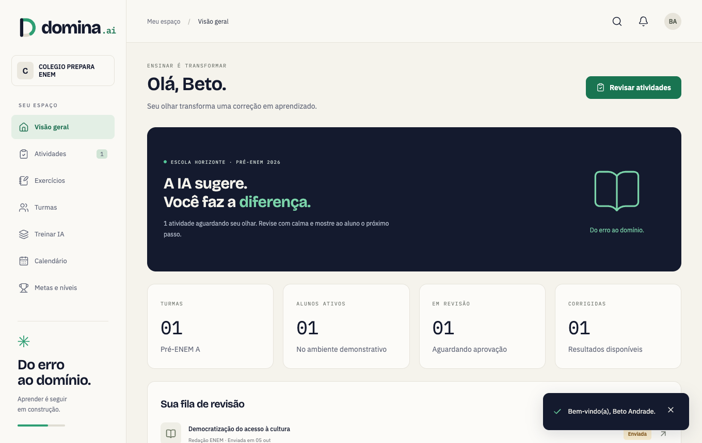 |
| Atividades (fila por atividade) | 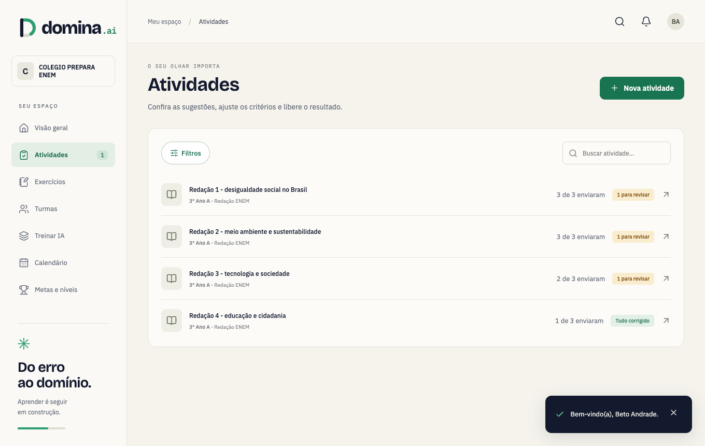 |
| Botão **Filtros** aberto (status com seleção múltipla) | 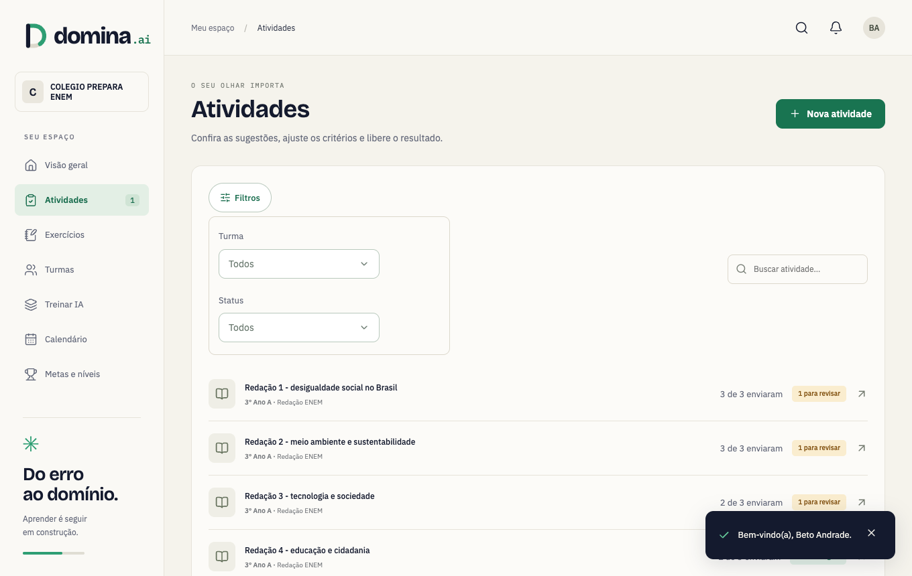 |
| Nova atividade (pop-up) | 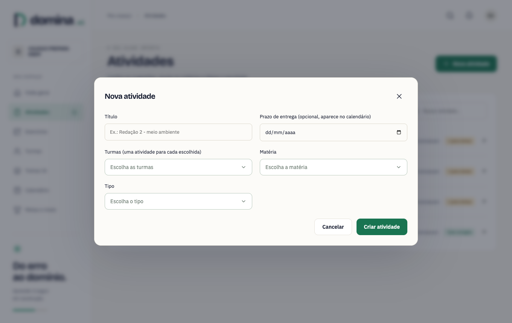 |
| Exercícios | 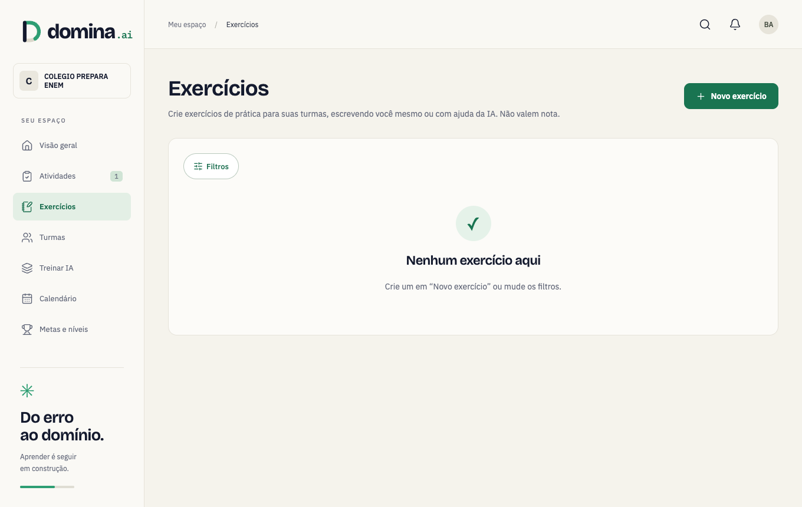 |
| Treinar IA | 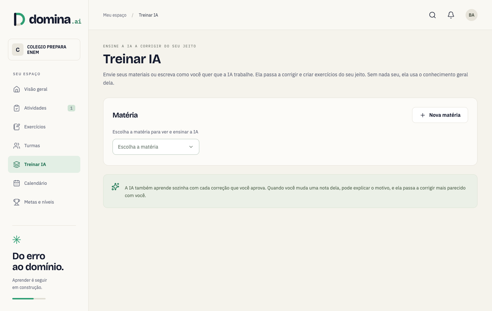 |
| Nova matéria (por área) | 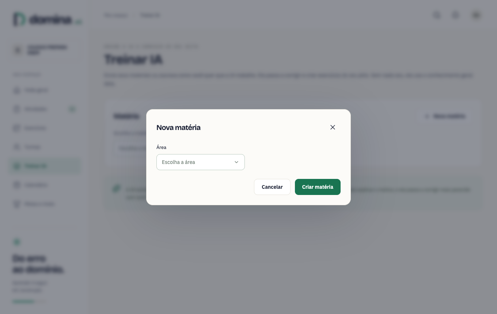 |
| Turmas | 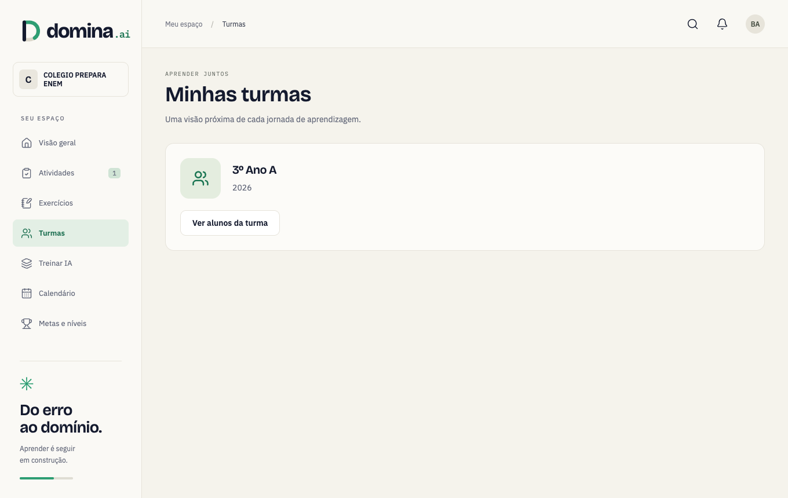 |
| Aluno: visão geral | 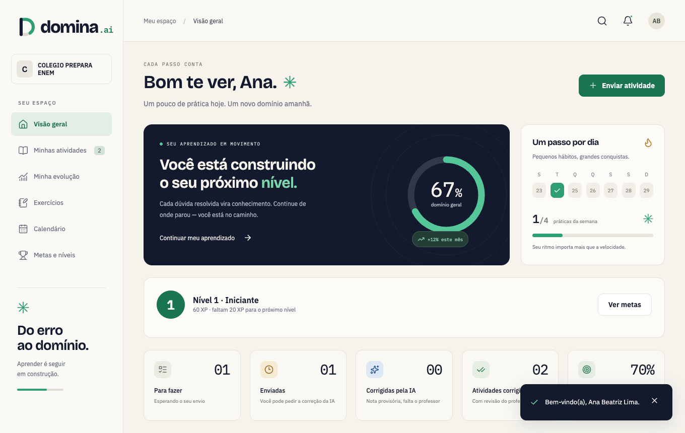 |
| Aluno: minhas atividades | 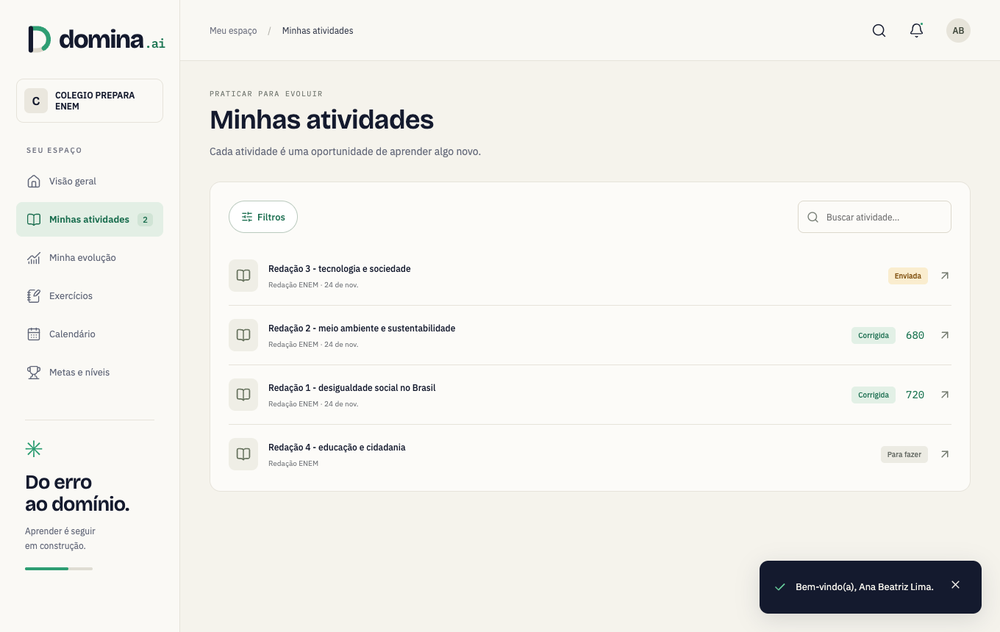 |
| Aluno: minha evolução | 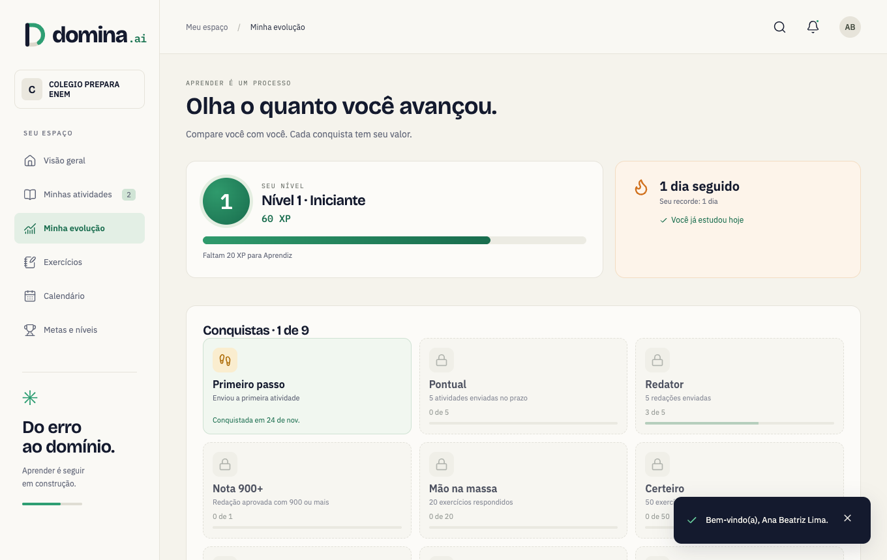 |

**Animação curta** (filtros, pop-up de nova atividade e lista de escolhas que abre ao clicar): [`docs/prints/video-escolhas-e-popups.gif`](https://github.com/igordobronx/domina/blob/domina-ciclo-3/docs/prints/video-escolhas-e-popups.gif?raw=true)

## O que mudou, por área

### Frontend (`frontend/`)
- **Padrões únicos de tela:** botão **Filtros** (`components/Filtros.tsx`) em Atividades, Exercícios e Materiais; criar/editar sempre em **pop-up** (`Modal`); escolhas em **lista que abre ao clicar** (`Seletor`, `SeletorMultiplo`, `Escolha`, nada pré-selecionado, nunca `<select>` nativo); poucas opções (2 ou 3) em botões lado a lado.
- **Atividades:** o menu "Revisões" virou **"Atividades"** e **"Exercícios"** fica logo abaixo. Status do filtro é múltipla escolha, com "Selecionar todos". Atividades mais recentes primeiro. Tipo "Exercício" virou **"Exercício avaliativo"**.
- **Nova atividade (igual ao exercício):** tipos Exercício avaliativo, Prova e Redação. "Como criar" (escrever ou pedir para a IA) e tipo das questões (objetiva/discursiva) lado a lado; total de pontos; questões com o mesmo editor do exercício (`EditorQuestao`), cada uma com pontos, **submatéria** e figura no topo; discursiva aceita até 5 respostas de exemplo. Trocar uma escolha apaga só o que depende dela.
- **Exercícios:** um exercício com **várias questões** (aluno vê "Próxima questão"); professor usa "Adicionar questão" e "Juntar todas num exercício" (IA).
- **Treinar IA:** tudo por matéria com seletor no topo; **"Nova matéria"** mora aqui (pop-up: escolhe a área e depois a matéria numa lista de sugestões); convive com os Assuntos da `main`.
- **Professor corrige direto**, sem a IA ter corrigido antes.
- **Aluno:** cards na ordem Para fazer, Enviadas, Corrigidas pela IA, Corrigidas, Domínio médio; status "Corrigida pela IA"; **Minha evolução** com `SeletorMultiplo` de matérias, 3 cards com "Ver mais" e subtópicos por matéria; XP, conquistas e sequência (branch de gamificação).
- **Turmas:** resumo do domínio do aluno ao clicar nele.
- **Tema escuro:** nada de cor fixa; só as variáveis do `styles.css`.

### Backend (`backend/`)
- **Matéria por área** (`materia.area`: EXATAS, NATUREZA, HUMANAS, LINGUAGENS, REDACAO, OUTRA). O formato da atividade vem do **tipo da atividade**, não da matéria (`tem_gabarito` = `valor_total` preenchido).
- **Pontos por questão** (`tema.valor`, `app/pontos.py::distribuir`): ou todas as questões têm pontos e a soma fecha o total, ou todas ficam em branco (divide igual); misturar é recusado. Correção, nota, evolução e memória usam o valor de cada questão.
- **Submatéria por questão** (`tema.subtopico`): o professor escreve ou a IA identifica (`app/subtopicos.py`, 1 chamada Haiku ao criar/editar). `/evolucao/minha` devolve os subtópicos por matéria.
- **Exercício com várias questões** (`exercicio.grupo_id` e `ordem`); `POST /exercicios/lote` aceita `mais_questoes`; excluir uma questão tira o grupo todo.
- **Agente de correção:** sempre corrige quando entende o envio (nota 0 com feedback se for o caso); `pedir_nova_foto` só quando é impossível ler; confiança em %; avaliação **Boa/Razoável/Ruim** com "por quê" opcional (vai para a memória da IA).
- **Professor corrige direto:** `GET /submissoes/{id}/correcao-manual`; `aprovar` cria a correção com `modelo_usado="professor"` (não entra na concordância com a IA).
- Resposta de exemplo obrigatória em questão discursiva (digitada ou "Gerar com IA").
- Listas de atividades da mais recente para a mais antiga (`atividade.criado_em`).

### IA própria / RAG
Já está na `main` (migrations 0024 a 0030: memória do professor, Treinar IA, material de treino). Aqui só entram ajustes: a IA aprende com exercícios e com a nota final do professor, e a avaliação Boa/Razoável/Ruim alimenta a memória.

### Migrations (todas novas neste PR; renumeradas depois do merge com a `main`)
| Nº | O quê |
|---|---|
| 0034 | `atividade.criado_em` |
| 0035 | `correcao_razoavel` |
| 0036 | `tema.subtopico` |
| 0037 | `materia.area` |
| 0038 | `tema.valor` (pontos da questão) |
| 0039 | `exercicio.grupo_id` e `ordem` |

(0031 a 0033 são da `main`: assuntos, anotações/avisos.)

### Testes
- Backend: `cd backend && python -m pytest -q tests/test_X.py` → **148 de 149 passaram** na suíte inteira; o único que falhou (`test_fluxo_envio`) passa sozinho (14 de 14), parece instável em suíte completa.
- Frontend: `npx tsc --noEmit -p .` limpo; `npm test` 14 de 14.
- Ajustei 3 testes da `main` (`test_anotacoes`, `test_assuntos`, `test_avisos`) para criar matéria com `area`.

## Como usar agora
1. `./dev.sh --seed` (ou `./dev.sh`), site em http://localhost:5173, API na 8000.
2. Professor: **Treinar IA → Nova matéria** (escolha a área); **Atividades → Nova atividade** (escolha o tipo e siga a ordem dos campos); **Exercícios → Adicionar questão**.
3. Aluno: **Minhas atividades** (abas por status) e **Minha evolução** (subtópicos por matéria).
4. Ao revisar, o professor só vê na fila as atividades que ele criou (regra da `main`); gestor vê todas.

## Fora deste PR / pendências
- Cada vestibular terá seu prompt de redação; hoje toda redação usa o do ENEM (v14).
- Escolher alunos (não só turma) no Exercício avaliativo em Atividades.

🤖 Generated with [Claude Code](https://claude.com/claude-code)
