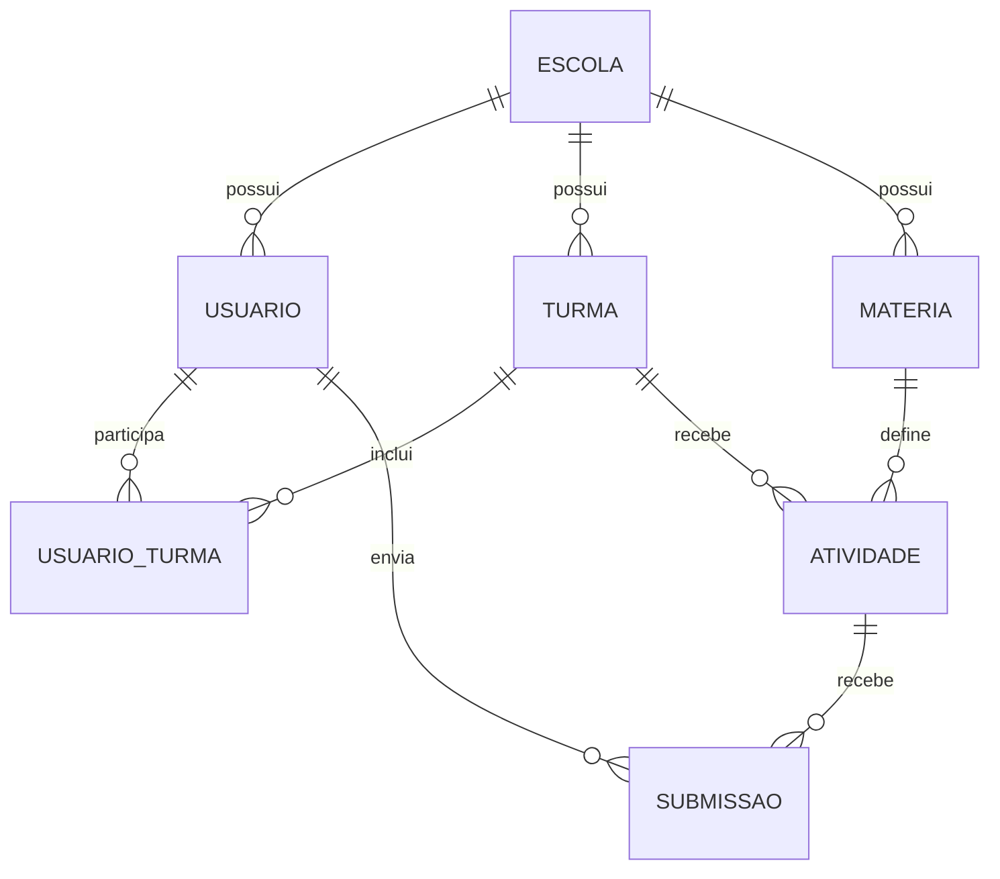

# Semana 1 — modelo reduzido, envio e listagem

Este é o recorte de dados necessário para receber e consultar uma redação no protótipo. O banco existente tem outras entidades para OCR, correção e diagnóstico; elas permanecem intactas. O recorte não exige migração nem cria novas tabelas.

## Modelo de dados reduzido

| Entidade | Campos necessários ao fluxo |
| --- | --- |
| `Escola` | `id`, `nome` |
| `Usuario` | `id`, `escola_id`, `nome`, `email`, `perfil` (`ALUNO` ou `PROFESSOR`) |
| `Turma` | `id`, `escola_id`, `nome`, `ano` |
| `UsuarioTurma` | `usuario_id`, `turma_id`, `papel` (`ALUNO` ou `PROFESSOR`); chave composta |
| `Materia` | `id`, `escola_id`, `nome`, `tipo` |
| `Atividade` | `id`, `materia_id`, `turma_id`, `titulo`, `tipo` |
| `Submissao` | `id`, `atividade_id`, `aluno_id`, `tipo_envio`, `conteudo_bruto`, `texto_ocr`, `texto_confirmado`, `criado_em` |

Cada submissão pertence a uma atividade e a um aluno. A atividade determina a turma e a matéria; essas relações permitem localizar a escola sem duplicar identificadores na submissão. O aluno precisa pertencer à turma da atividade. O professor pode enviar em nome de um aluno dessa turma. O acesso à listagem é limitado à própria escola e aos vínculos de usuário e turma.

Para `tipo_envio=TEXTO`, `conteudo_bruto` e `texto_confirmado` guardam o texto digitado após remover espaços das extremidades, e `texto_ocr` é nulo. Para `tipo_envio=IMAGEM`, `conteudo_bruto` guarda o caminho do arquivo e `texto_ocr` guarda a leitura automática; `texto_confirmado` só é preenchido após conferência. A data de envio é `criado_em`.

## Contrato dos endpoints

Todos exigem token Bearer. `POST /submissoes/texto` recebe JSON com `atividade_id` (UUID), `texto` (1 a 20.000 caracteres; não pode conter apenas espaços) e `aluno_id` (UUID opcional, obrigatório para professor). O aluno autenticado sempre envia em nome próprio. O retorno é `201` com `SubmissaoResponse`. O envio de imagem existente continua em `POST /submissoes/imagem`, seguido de `PUT /submissoes/{id}/confirmar`.

`GET /submissoes` retorna uma lista de `SubmissaoResponse` sem `conteudo_bruto`, nota ou feedback. Aceita `atividade_id` opcional, `limit` de 1 a 100 (padrão 50) e `offset` a partir de zero (padrão zero). A ordem é `criado_em` decrescente, com `id` decrescente para desempate. O aluno vê apenas seus envios; o professor vê os envios das suas turmas. Uma atividade fora do alcance do usuário retorna `404`; perfis diferentes de aluno e professor recebem `403`.

O PDF de uma produção e o fluxo de aprovação da nota não fazem parte deste incremento.
